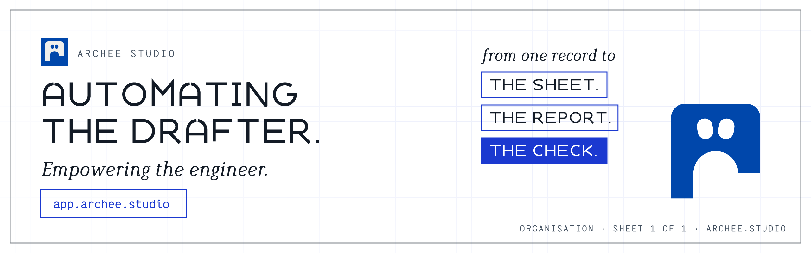

<picture>
  <source media="(prefers-color-scheme: dark)" srcset="https://raw.githubusercontent.com/Archee-Studio/.github/main/profile/assets/banner-dark.png">
  
</picture>

**Automating the drafter. Empowering the engineer.** Archee Studio is agentic CAD for mechanical design: describe the machine, and the agent works out the calculations, drafts editable DXF and DWG sheets and writes the report, all from one design record you can check. Drop in your DXF, point at the part, say what is wrong, and Tobi, the Archee agent, draws it again: from one record to the sheet, the report and the check.

[Open the app](https://app.archee.studio) · [Website](https://archee.studio) · [Docs](https://docs.archee.studio) · [Download](https://archee.studio/download/)

| Repository | |
| --- | --- |
| [archee-studio](https://github.com/Archee-Studio/archee-studio) | Bug reports, feature requests, known issues |
| [archee-cli](https://github.com/Archee-Studio/archee-cli) | Connect a folder on your computer |
| [archee-desktop](https://github.com/Archee-Studio/archee-desktop) | macOS and Windows app |
| [homebrew-tap](https://github.com/Archee-Studio/homebrew-tap) | `brew install archee-studio/tap/archee-cli` |

Piloting at HCMUT · AWS Activate · NVIDIA Inception · [team@archee.studio](mailto:team@archee.studio)
