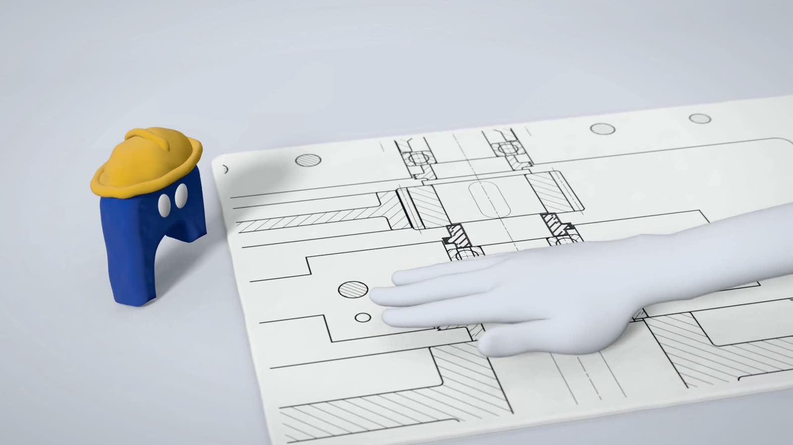

# Archee Studio

**Automating the drafter. Empowering the engineer.**

Archee Studio is an AI assistant for mechanical design. Tell it what you are designing: it works through the calculations with you, prepares drawings you can edit (DXF and DWG) and writes the report for you to review.

[Website](https://archee.studio) · [Open the app](https://app.archee.studio) · [Docs](https://docs.archee.studio) · [Download](https://archee.studio/download/)

## Repositories

| Repository | What it is |
| --- | --- |
| [archee-studio](https://github.com/Archee-Studio/archee-studio) | Product home: known issues, bug reports and feature requests |
| [archee-cli](https://github.com/Archee-Studio/archee-cli) | `archee`, the command line that connects a folder on your computer |
| [archee-desktop](https://github.com/Archee-Studio/archee-desktop) | Archee Studio for macOS and Windows |
| [homebrew-tap](https://github.com/Archee-Studio/homebrew-tap) | Homebrew formulae and casks |

Piloting at HCMUT · AWS Activate · Member of the NVIDIA Inception Program

Contact: [team@archee.studio](mailto:team@archee.studio)
